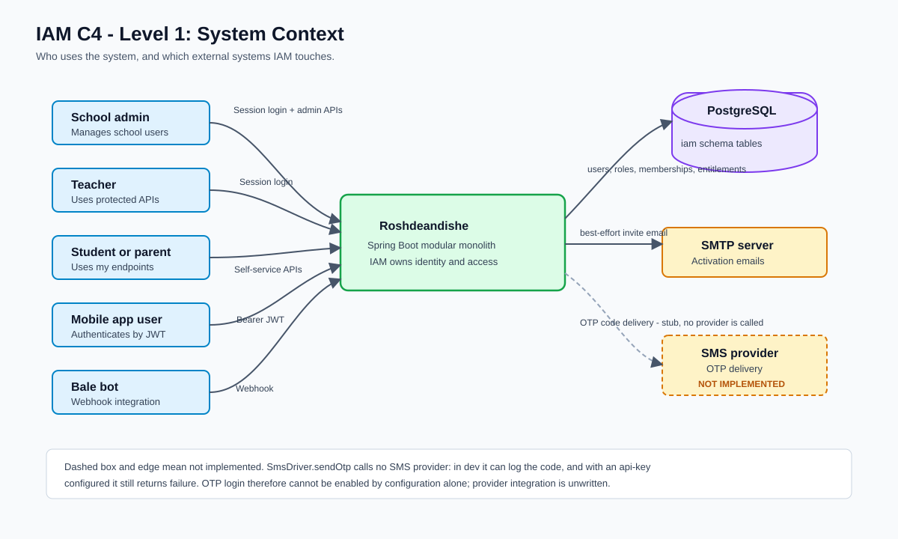
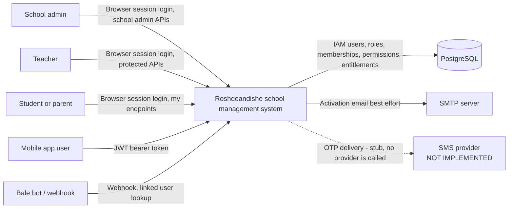
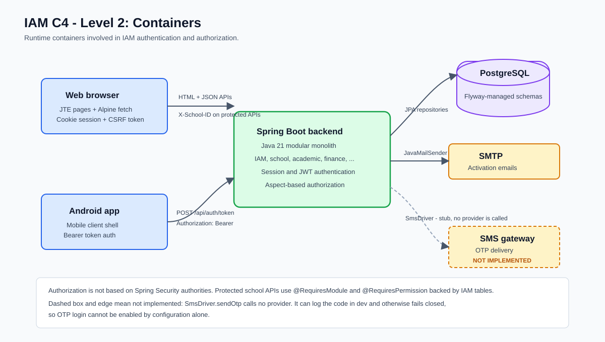
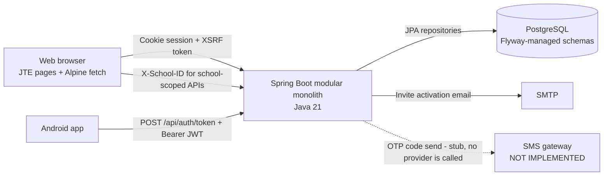
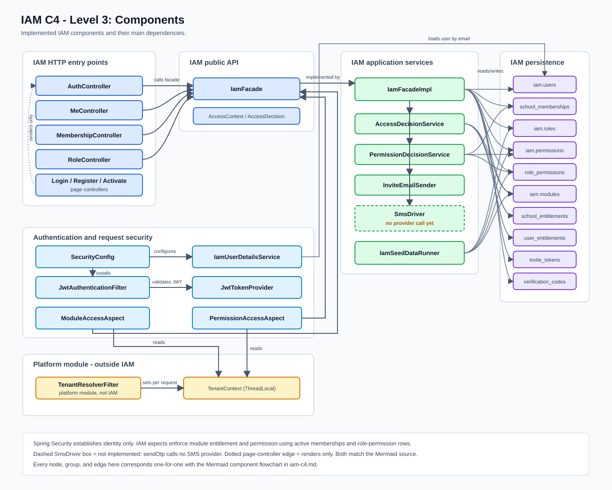
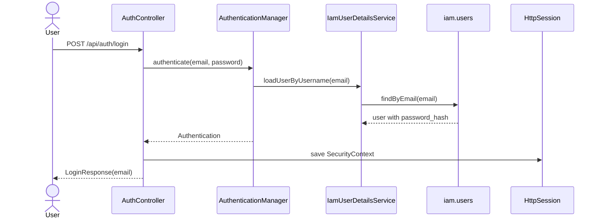
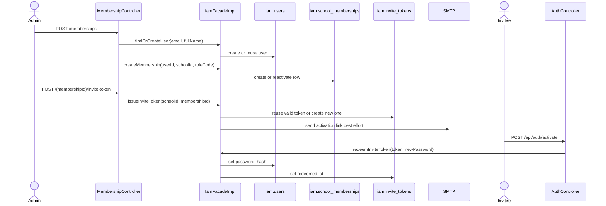

# IAM C4 View

Status: current behavior checked against source, migrations, and tests on 2026-08-14.

This document is a C4-style view of the IAM module. It describes the implemented
system shape only; future platform-admin, billing, and B2C entitlement workflows
are noted as limits where the code has no complete public path.

The static SVG images below are the primary diagrams. The IntelliJ PlantUML
source is [`iam-c4.puml`](iam-c4.puml), which holds all six diagrams as separate
`@startuml` blocks:

- `iam_c4_context`
- `iam_c4_containers`
- `iam_c4_components`
- `iam_c4_password_login`
- `iam_c4_school_scoped_authorization`
- `iam_c4_member_invite_activation`

Mermaid source remains under each image for editors and viewers that can render
Mermaid directly. The three flow diagrams have no rendered SVG; read the Mermaid
below or render the PlantUML source.

## Level 1: System Context





The dashed edge to the SMS provider is an unimplemented stub, not current
behavior. `SmsDriver.sendOtp` calls no provider: without an API key it can log
the code in dev and otherwise fails closed, and with an API key configured it
still returns failure. OTP delivery cannot be enabled by configuration alone.

## Level 2: Containers





As in the context diagram, the dashed SMS gateway edge marks an unimplemented
stub rather than a deployed integration.

The backend is one Spring Boot artifact, not a Maven multi-module reactor.
Spring Modulith treats top-level packages as application modules. IAM is the
module that exposes identity and authorization contracts to the rest of the
monolith.

## Level 3: IAM Components



The SVG and the Mermaid below are one-for-one: same 31 nodes, same six
groups, same 38 edges. If you change one, change the other — the SVG is
hand-laid-out, so it does not regenerate from the Mermaid.

CI enforces this. [`scripts/check-diagram-parity.py`](../../scripts/check-diagram-parity.py)
recovers the graph from the SVG geometry — each node rect carries a
`data-node` attribute holding its Mermaid id, and every edge path's
endpoints are resolved to the boxes they touch — then diffs it against the
Mermaid both ways. Run it locally with:

```bash
python3 scripts/check-diagram-parity.py --verbose
```



```mermaid
flowchart TB
    subgraph publicApi[IAM public API]
        facade[IamFacade]
        accessContext[AccessContext / AccessDecision]
    end

    subgraph http[IAM HTTP entry points]
        auth[AuthController]
        me[MeController]
        memberships[MembershipController]
        roles[RoleController]
        pages[Login / Register / Activate page controllers]
    end

    subgraph security[Authentication and request security]
        securityConfig[SecurityConfig]
        userDetails[IamUserDetailsService]
        jwtProvider[JwtTokenProvider]
        jwtFilter[JwtAuthenticationFilter]
        moduleAspect[ModuleAccessAspect]
        permissionAspect[PermissionAccessAspect]
    end

    subgraph platform[Platform module - outside IAM]
        tenantFilter[TenantResolverFilter]
        tenantContext[TenantContext ThreadLocal]
    end

    subgraph app[IAM application services]
        facadeImpl[IamFacadeImpl]
        moduleDecision[AccessDecisionService]
        permissionDecision[PermissionDecisionService]
        inviteSender[InviteEmailSender]
        smsDriver[SmsDriver\nno provider call yet]
        seed[IamSeedDataRunner]
    end

    subgraph persistence[IAM persistence]
        users[(iam.users)]
        membershipsTable[(iam.school_memberships)]
        rolesTable[(iam.roles)]
        permissionsTable[(iam.permissions)]
        rolePermissions[(iam.role_permissions)]
        modulesTable[(iam.modules)]
        schoolEntitlements[(iam.school_entitlements)]
        userEntitlements[(iam.user_entitlements)]
        inviteTokens[(iam.invite_tokens)]
        verificationCodes[(iam.verification_codes)]
    end

    auth --> facade
    me --> facade
    memberships --> facade
    roles --> facade
    pages -.renders only.-> auth

    securityConfig --> userDetails
    securityConfig --> jwtFilter
    jwtFilter --> jwtProvider
    moduleAspect --> facade
    permissionAspect --> facade
    tenantFilter -->|sets per request| tenantContext
    moduleAspect -->|reads| tenantContext
    permissionAspect -->|reads| tenantContext

    facade --> facadeImpl
    facadeImpl --> moduleDecision
    facadeImpl --> permissionDecision
    facadeImpl --> inviteSender
    facadeImpl --> smsDriver

    userDetails --> users
    facadeImpl --> users
    facadeImpl --> membershipsTable
    facadeImpl --> rolesTable
    facadeImpl --> permissionsTable
    facadeImpl --> rolePermissions
    facadeImpl --> modulesTable
    facadeImpl --> schoolEntitlements
    facadeImpl --> inviteTokens
    facadeImpl --> verificationCodes

    moduleDecision --> modulesTable
    moduleDecision --> schoolEntitlements
    moduleDecision --> userEntitlements
    permissionDecision --> membershipsTable
    permissionDecision --> permissionsTable
    permissionDecision --> rolePermissions
    seed --> modulesTable
    seed --> rolesTable
    seed --> permissionsTable
    seed --> rolePermissions
```

## Main Flows

### Password Login



### School-Scoped Authorization

```mermaid
sequenceDiagram
    actor Client
    participant TenantResolverFilter
    participant ModuleAccessAspect
    participant PermissionAccessAspect
    participant IamFacade
    participant AccessDecisionService
    participant PermissionDecisionService
    participant Controller

    Client->>TenantResolverFilter: API request with X-School-ID
    TenantResolverFilter->>TenantResolverFilter: set TenantContext
    Note over ModuleAccessAspect,PermissionAccessAspect: @RequiresModule and @RequiresPermission are independent.<br/>A method may carry either, both, or neither; each aspect<br/>reads TenantContext itself. Both shown here for completeness.
    ModuleAccessAspect->>IamFacade: checkAccess(user, module, school)
    IamFacade->>AccessDecisionService: decide(...)
    AccessDecisionService-->>ModuleAccessAspect: granted or denied
    PermissionAccessAspect->>IamFacade: checkPermission(user, permission, school)
    IamFacade->>PermissionDecisionService: decide(...)
    PermissionDecisionService-->>PermissionAccessAspect: granted or denied
    PermissionAccessAspect->>Controller: proceed if granted
    Controller->>Controller: TenantContext.requireMatches(path schoolId)
```

### Add Member And Activate Account



## Component Responsibilities

| Component | Responsibility |
|---|---|
| `IamFacade` | Public cross-module contract for identity, memberships, entitlements, roles, and access checks. |
| `IamFacadeImpl` | Transaction boundary for IAM mutations and orchestration of repositories, password hashing, invite email, and OTP. |
| `AuthController` | JSON authentication endpoints for session login, JWT token issue, registration, activation, logout, and OTP login. |
| `MeController` | Authenticated current-user profile, memberships, and phone number update. |
| `MembershipController` | School admin membership creation, listing, activation toggling, member-name lookup, and invite-token issue. |
| `RoleController` | School admin custom-role creation and permission/role listing. |
| `SecurityConfig` | Session authentication, additive JWT bearer authentication, CSRF policy, public paths, and API vs page entry points. |
| `ModuleAccessAspect` | Enforces `@RequiresModule` through school or user entitlement checks. |
| `PermissionAccessAspect` | Enforces `@RequiresPermission` through active school memberships and role permissions. |
| `AccessDecisionService` | Chooses entitlement source by module scope: `PLATFORM` grants unconditionally to any authenticated caller, `SCHOOL` checks `school_entitlements` for the context school, `USER` checks `user_entitlements` for the caller. |
| `PermissionDecisionService` | Grants only when an active membership role has the required permission. |
| `TenantResolverFilter` | Belongs to the `platform` module, not IAM. Reads the `X-School-ID` header on non-excluded paths and sets the `TenantContext` ThreadLocal. The IAM aspects read that context; the filter never calls them. |
| `SmsDriver` | Unimplemented OTP delivery stub. `sendOtp` calls no SMS provider: with a blank `roshdeandishe.sms.api-key` it logs the code and returns success only when `roshdeandishe.sms.dev-log-codes` is on, and with an API key set it logs an error and returns failure. No configuration makes it deliver a message. |
| `IamSeedDataRunner` | Idempotently seeds reference catalog data: modules, system roles, permissions, and role-permission grants. It seeds demo admin data outside `prod`. |

## Current Limits

- `PLATFORM_ADMIN` exists as a seeded role but has no complete current
  permission-check path and is hidden from role-management UI responses.
- `USER`-scoped module checks exist through `user_entitlements`, but there is no
  public facade/API workflow to grant user entitlements yet.
- Real SMS provider integration is not implemented, and setting
  `roshdeandishe.sms.api-key` does not enable it — `SmsDriver.sendOtp` has no
  provider call at all and returns failure on that path. Only
  `roshdeandishe.sms.dev-log-codes` produces a usable code, by logging it. The
  SMS provider is drawn dashed in the context and container diagrams for this
  reason.

## Evidence

- Current architecture: [`openspec/architecture.md`](../architecture.md)
- Current system spec: [`openspec/specs/current-system.md`](../specs/current-system.md)
- Public IAM contract: [`IamFacade.java`](../../src/main/java/com/example/roshdeandishe/iam/IamFacade.java)
- IAM application service: [`IamFacadeImpl.java`](../../src/main/java/com/example/roshdeandishe/iam/internal/IamFacadeImpl.java)
- Security configuration: [`SecurityConfig.java`](../../src/main/java/com/example/roshdeandishe/iam/shared/SecurityConfig.java)
- Tenant header filter: [`TenantResolverFilter.java`](../../src/main/java/com/example/roshdeandishe/platform/TenantResolverFilter.java)
- IAM schema tables: [`V1__baseline_schema.sql`](../../src/main/resources/db/migration/V1__baseline_schema.sql)
- IAM flow tests: [`LoginDashboardFlowIntegrationTest.java`](../../src/test/java/com/example/roshdeandishe/LoginDashboardFlowIntegrationTest.java),
  [`RegistrationFlowIntegrationTest.java`](../../src/test/java/com/example/roshdeandishe/RegistrationFlowIntegrationTest.java),
  [`MembershipManagementFlowIntegrationTest.java`](../../src/test/java/com/example/roshdeandishe/MembershipManagementFlowIntegrationTest.java),
  [`RoleManagementFlowIntegrationTest.java`](../../src/test/java/com/example/roshdeandishe/RoleManagementFlowIntegrationTest.java),
  [`MobileAuthFlowIntegrationTest.java`](../../src/test/java/com/example/roshdeandishe/MobileAuthFlowIntegrationTest.java),
  [`OtpLoginFlowIntegrationTest.java`](../../src/test/java/com/example/roshdeandishe/OtpLoginFlowIntegrationTest.java)
